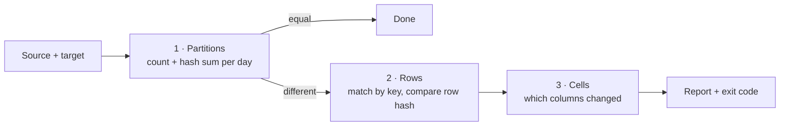

# table-diff

[](https://github.com/ecuadrosg36/table-diff/actions/workflows/ci.yml)

**Prove a data migration is right.** `table-diff` compares a legacy table with its migrated copy and tells you
exactly what differs: which days, which rows, which columns. It filters out the harmless noise that every
migration adds, so you only see real bugs.

```text
$ table-diff-demo
Without noise rules: 30 of 30 partitions differ and 990,401 rows look changed.

With --float-decimals 6 --trim --empty-as-null:

# table-diff: DIFFERENCES FOUND
- Source: 1,000,000 rows · Target: 990,551 rows
- Partitions checked: 30, with differences: 4
- Time: 0.09s

| finding           |  keys | examples                     |
|-------------------|------:|------------------------------|
| missing_in_target | 9,524 | order_id=16; order_id=166; … |
| duplicate_key     |    75 | order_id=8; order_id=38; …   |
| changed           |   955 | order_id=22; order_id=1012; …|

Changed rows per column:  status: 955
| order_id=22 | status | shipped | paid |
```

Without the rules, every row looks wrong. With them, the report shows the three real bugs planted in the
demo: refunded orders dropped on one day, a retry that loaded 75 orders twice, and a status mapping that turned
`shipped` into `paid`.

## The problem

When you move pipelines from one platform to another (say SQL Server to Snowflake, or Hive to Databricks),
someone has to answer: *is the new table the same as the old one?* Row counts are not enough. Counts can match
while values are wrong, and a full row-by-row comparison of every table is slow and buries you in false alarms:

- floats drift by `0.000000001` after a type change,
- `CHAR` columns come back padded with spaces,
- empty strings become `NULL`.

## How it works

Three passes, each looking at less data than the one before:



1. **Partitions.** For each day (or any partition column), compute the row count and the sum of row hashes.
   The sum does not depend on row order, so the check works even when the two systems return rows differently.
   Matching partitions are done and never scanned again.
2. **Rows.** Only inside partitions that differ, join the two sides by key. Each key is classified as
   `missing_in_target`, `extra_in_target`, `duplicate_key` or `changed`.
3. **Cells.** Only for changed rows, count differences per column and keep examples with both values.

Before hashing, every column goes through the **noise rules** you turn on:

| Option | What it ignores | Typical cause |
|---|---|---|
| `--float-decimals N` | Differences beyond N decimal places | `DECIMAL` → `DOUBLE`, currency conversions |
| `--trim` | Leading and trailing spaces | `CHAR(n)` padding |
| `--empty-as-null` | `''` vs `NULL` | Loaders that convert empty strings |
| `--ignore COL` | A whole column | Load timestamps, surrogate keys |

`DECIMAL` and `DOUBLE` holding the same number are always equal. The type change is still listed in the schema
section. `NULL` is never equal to the text `'NULL'`.

## Use it

```bash
uv sync
uv run table-diff-demo                       # build fake tables and compare them

uv run table-diff legacy.parquet migrated.parquet \
    --key order_id --partition order_date \
    --float-decimals 6 --trim --empty-as-null

uv run table-diff legacy.orders orders --key order_id --db warehouse.duckdb --format json
```

Sources can be Parquet, CSV or JSON files, or tables inside a DuckDB database file. Composite keys repeat
`--key`. Timestamp partitions are grouped by day.

**Exit codes:** `0` the tables match · `1` differences found · `2` could not compare (missing column, bad file).
That makes it a gate you can put after each migrated pipeline in CI or in an orchestrator.

From Python:

```python
import duckdb
from table_diff import DiffOptions, compare, to_markdown

with duckdb.connect() as con:
    report = compare(con, "legacy.parquet", "migrated.parquet",
                     DiffOptions(key=("order_id",), partition="order_date", float_decimals=6))
    print(to_markdown(report))
```

## Design decisions

- **DuckDB does the work.** All three passes are SQL, so the data never has to fit in Python memory. On an
  Apple M4 Pro, the 1,000,000-row demo compares in under 0.1 seconds.
- **Hash sums, not XOR.** XOR cancels out pairs of identical rows, so a duplicated row would go unnoticed. A sum
  of 64-bit hashes stored as `HUGEINT` changes when a row is duplicated.
- **Hash a list, not a joined string.** `hash(list_value(a, b))` keeps `('a|b', 'c')` and `('a', 'b|c')` apart,
  and keeps `NULL` apart from the text `'NULL'`.
- **Noise rules are explicit flags.** The tool never hides a difference unless you asked it to, and the report
  shows which rules were on.
- **Every name and path is quoted.** Table names, column names and file paths go through identifier and literal
  quoting, never raw string pasting.

## Limits

- Both tables have to be readable from one DuckDB connection. Files and DuckDB databases work today.
- Hash comparison finds *that* a row changed; the cell pass explains *how* only for the first `--max-samples`
  rows. Column counts cover all changed rows.
- A 64-bit hash can collide in theory. For a migration check, the chance is far below other sources of error.

## Next

- Read straight from Postgres and Snowflake through DuckDB extensions, and push the partition pass down to the
  warehouse so only the summaries travel.
- Tolerances per column (e.g. `amount` ± 0.01) instead of one global setting.
- An HTML report with a calendar heat map of partitions.

## Development

```bash
uv sync
uv run pytest            # 32 tests, ~99% coverage
uv run ruff check src tests
```

All demo and test data is generated. Nothing comes from a real company.

MIT License.
